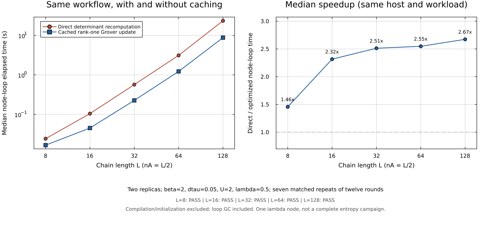

# Matched Rényi node-loop timing

This record compares the same locally lazy two-replica workflow **with and without rank-one Grover caching**. The primary metric is the ratio of median elapsed node-loop times; update-kernel results remain separate.

The largest completed passing registered case, **L=128, nA=64**, ran **2.673× faster**: 23.4104 s direct versus 8.75864 s optimized. All sizes are shown below.

| L | nA | Status | Paired repeats | Direct median (s) | Optimized median (s) | Node-loop speedup | Timing-jitter 95% interval | Update-kernel speedup |
|---:|---:|---|---:|---:|---:|---:|---|---:|
| 8 | 4 | PASS | 7/7 | 0.0242272 | 0.0166312 | 1.4567× | [1.4231, 1.4688] | 1.4584× |
| 16 | 8 | PASS | 7/7 | 0.104514 | 0.0451355 | 2.3156× | [2.3009, 2.4128] | 2.3174× |
| 32 | 16 | PASS | 7/7 | 0.567533 | 0.225904 | 2.5123× | [2.4897, 2.6791] | 2.5155× |
| 64 | 32 | PASS | 7/7 | 3.11652 | 1.22332 | 2.5476× | [2.5246, 2.5979] | 2.549× |
| 128 | 64 | PASS | 7/7 | 23.4104 | 8.75864 | 2.6728× | [2.6287, 2.6909] | 2.6737× |

## Allocations

These are median cumulative allocated bytes inside each timed node loop, including allocation churn. They do not measure peak resident memory. The reduction ratio is direct median bytes divided by optimized median bytes.

| L | nA | Direct median allocated bytes | Optimized median allocated bytes | Allocation reduction |
|---:|---:|---:|---:|---:|
| 8 | 4 | 27956832 | 1203456 | 23.23× |
| 16 | 8 | 147170800 | 2434752 | 60.446× |
| 32 | 16 | 1023934304 | 5513056 | 185.73× |
| 64 | 32 | 7792731168 | 14086976 | 553.19× |
| 128 | 64 | 6.158115338e+10 | 40970176 | 1503.1× |

## Scope and fairness

Fixed physics: nearest-neighbor periodic Hubbard chain, t=1, U=2, centered mu=0, beta=2, dtau=0.05, lambda=0.5, nA=L/2 and stabilization period 5. Both paths use the corrected 50% independent idle decision before every local proposal. Both start from clones of identical warmed states and RNG streams; execution order alternates. The production protocol uses seven repeats of twelve two-replica rounds. The same forward/backward and endpoint ratio measurements and sweep-boundary snapshots are included.

Initialization, common warmup, compilation, deep copies and explicit GC are outside the primary timer. Allocation-triggered GC inside the measured loop is included. Raw allocation, GC and component timings are preserved in [timing_repeats.csv](timing_repeats.csv). The bootstrap interval measures repeat-to-repeat timing jitter on this host, not performance variation across machines.

The direct baseline rebuilds subsystem Grover matrices and refactors determinants for proposals. The optimized path maintains their determinant and inverse, uses rank-one updates, avoids redundant full candidate-state copying/rebuilding, and reconstructs at registered stabilization boundaries with conditioning safeguards. This is a Grover-update measurement; it does not establish an isolated speedup for ordinary equal/unequal-time Green functions.

## Correctness

Every accepted timing case must reproduce sweep-boundary auxiliary fields, sweep acceptance rates, determinant signs and next RNG draws exactly. Full Green matrices, determinant logs and all ratio observations are checked numerically. Maximum discrepancies across every retained repeat are:

- `maximum_Green_absolute_error`: 0
- `maximum_logdet_absolute_error`: 0
- `maximum_measurement_absolute_error`: 0
- `maximum_measurement_relative_error`: 0
- `maximum_reported_deltaG`: 9.7122137e-13

These checks establish matched sampled trajectories at the recorded sweep boundaries. They are not an independent proof of the final entropy’s physical accuracy, which belongs to the external scientific benchmark campaign. Failed and unresolved sizes remain visible.

## Provenance

- Recorded UTC: 2026-10-22T17:19:02.700 to 2026-10-22T17:23:51.215
- Host / Slurm job: `clr1450` / `6456993`
- CPU: `model name	: Intel(R) Xeon(R) Gold 6248R CPU @ 3.00GHz`
- Julia / threads / BLAS threads: `1.12.1` / `1` / `1`
- Seeds: `[940031, 940032]`
- Receipt SHA256: `26216f983e52299fdcd98f1b8dc48b22830f18aaa7df89c4ca9a01e837b6fa2d`
- Benchmark runner SHA256: `56ce5e3c395df4aeb1fe0b7654e315a81e280c74b2f65bb0b0ab65a010d06c49`
- Analysis script SHA256: `d0e7a6676450404fa02a8fdaa9bb10276acbffebdd3d62d6cd4a61ec7ea422f9`

Source hashes:

- `src/HubbardRenyiDQMC.jl`: `336f4393cd69b04ffc1b8c42f97207d719a4ab88cbbd1d343a8088234bffc721`
- `Project.toml`: `ea3b7eacfcf9a36e4652654a5e7b573ef27529edfbad2e272da2bafca1a7f58f`
- `src/dqmc_kernel.jl`: `b72bbbf158381b0f776c1fa259d532b069094c47e361d3490c19ea0f43ada4be`
- `Manifest.toml`: `5cefaf1acdb4fa23a456c2c58f20fb1fcebd54b3cd27bc448cb65b0fcfecb90e`
- `src/grover_rank1_update.jl`: `79064a0aa868ff7b5c665876bc5dd6eeeee17da2684b7a04807891c81d0d358e`

BLAS configuration: `LBTConfig([ILP64] libopenblas64_.so)`

Full metadata and every row are in [timing_summary.json](timing_summary.json); compact values are in [timing_summary.csv](timing_summary.csv).

A standard scientific figure was rendered separately with the pinned Plots.jl package on ISAAC:

[PDF figure](../matched_timing_scaling_20261022.pdf) · [Plot provenance](../matched_timing_scaling_20261022_plot_receipt.toml). The optional Python plot export was unavailable because matplotlib was not installed.

## Scoped CV wording

Optimized Rényi entropy sampling with cached rank-one Grover updates, achieving 2.7× faster matched node-loop execution at L=128 (nA=64) versus direct determinant recomputation on ISAAC.

This wording identifies the tested algorithm and workload. The largest completed registered size was selected by size, not by searching for the largest observed ratio. The full table must accompany the public evidence record.
