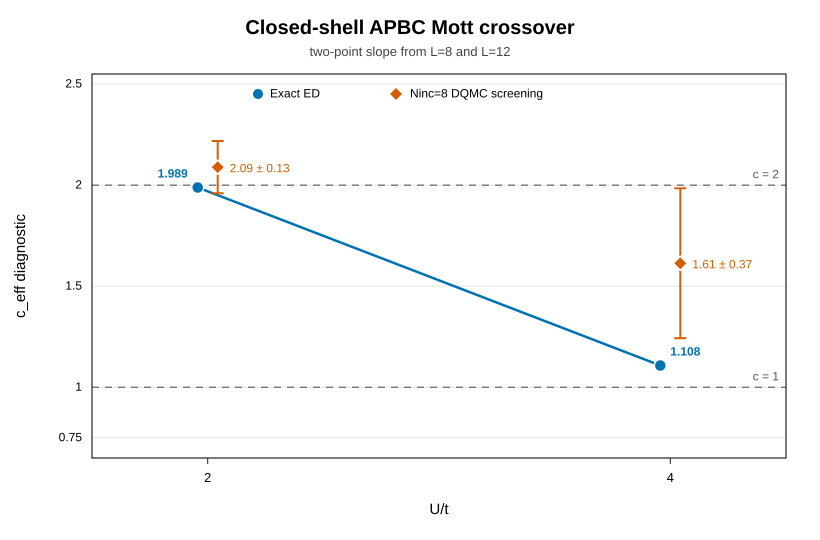

# DQMC Renyi-2 Entanglement Entropy Study

## Result

This repository computes the second Renyi entropy of a contiguous subsystem in
the periodic, half-filled, one-dimensional Hubbard model at `U/t=2`. The active
DQMC implementation is validated against exact diagonalization (ED), DMRG, and
long-burn checks. Its optimized nonzero-lambda update is `3.8236x` faster on the
matched L=10 production workload used for validation.

The finite-size study reaches L=22. DQMC and the ground-state references agree,
but the data retain a strong `L mod 4` oscillation. Simple finite-window fits are
not adequate, so this study makes no central-charge claim.

## Model and estimator

The benchmark convention is `t=1`, `U=2`, `mu=0`, a periodic chain, and a
contiguous subsystem `C=1:nA`. DQMC is grand canonical and at finite inverse
temperature `beta`; half filling follows from particle-hole symmetry. ED and
DMRG use fixed-particle-number ground states.

The physical quantity is

```text
S2 = -log(Tr(rho_A^2)) = -log(Z(1)/Z(0)).
```

For the two DQMC replicas and each spin, define the subsystem Grover matrix

```text
g = G1*G2 + (I - G1)*(I - G2),
X = det(g_up) * det(g_dn).
```

The interpolating ensemble contains the weight `X^lambda`. On a grid
`lambda_k=k/Ninc` with `delta_lambda=1/Ninc`, the adjacent ratios are

```text
R_plus(lambda_k) = Z(lambda_k + delta_lambda) / Z(lambda_k),
Z(1)/Z(0) = product_k R_plus(lambda_k),
S2 = -sum_k log(R_plus(lambda_k)).
```

Interior nodes also measure the backward ratio. The product
`R_plus(lambda_k)*R_minus(lambda_{k+1})` is a consistency diagnostic, not an
additional factor in the final estimator.

## Why the Grover weight and unequal-time Green's functions are required

For a local auxiliary-field proposal, the Metropolis probability contains

```text
min(1, abs(R_up*R_dn) * (X_new/X_old)^lambda).
```

The Grover factor therefore changes the distribution sampled at nonzero
`lambda`. Removing it would sample the ordinary `lambda=0` DQMC distribution
and would not produce the intended estimator.

A proposal is made at an imaginary-time slice, while `X` is built from the
time-zero Green's function `G00`. The proposed subsystem update has the form

```text
G00_new[C,C] = G00[C,C] + p*q^T,
p proportional to G0tau[C,i],
q^T = Gtau0[i,C].
```

Thus `G0tau` and `Gtau0` are the information needed to evaluate the change in
the Grover weight away from time zero. They are not optional diagnostics or
redundant copies.

## Implementation and speed

The optimization preserves the proposal weight but avoids rebuilding and
factorizing the Grover matrix for every proposal. If
`G1_new=G1+p*q^T`, then

```text
g_new = g + p*r^T,
r^T = q^T*(2*G2 - I),
det(g_new)/det(g) = 1 + r^T*inv(g)*p.
```

This changes the Grover determinant-ratio work from `O(nA^3)` to `O(nA^2)`.
The implementation carries the current subsystem block, determinant, and
inverse; updates them only after acceptance; and rebuilds at stabilization
boundaries or when a numerical guard fails. The inverse-update multiplication
needed only after acceptance is deferred until then.

The local launcher uses a rolling worker pool and fixes each worker to one BLAS
thread, avoiding idle batch tails and CPU oversubscription. These are scheduling
changes only; they do not change the Markov chain or estimator.

The validation suite passed 2,318 checks, including 12 same-seed
direct-versus-optimized DQMC rounds. On the isolated L=8 kernel benchmark, mean
time changed from `0.550769 s` to `0.204545 s` (`2.692658x`) and mean allocation
from `1278.946 MiB` to `11.415 MiB`. On the matched L=10 production workload,
the mean runtime across 28 interior nodes changed from `95.9854 s` to
`25.1035 s`, a `3.8236x` speedup. All 36 optimized bin files matched the
validated historical bins after excluding the intentionally different
run-name field.

These timings describe those fixed workloads and are not universal hardware
performance guarantees.

## Physics validation

At L=10, `beta=40`, `dtau=0.05`, and `Ninc=16`, all five contiguous subsystem
sizes `nA=1:5` agree with ED within `0.6` DQMC standard errors. For the
half-chain,

```text
S2_DQMC = 1.716441955736 +/- 0.003040377094
S2_ED   = 1.716551661433
z       = -0.036
```

The largest validated sizes are

| L | beta | S2 DQMC | DQMC 1 sigma | S2 DMRG | difference / DQMC sigma |
|---:|---:|---:|---:|---:|---:|
| 20 | 80 | 1.805179361272 | 0.008209270540 | 1.808766655046 | -0.437 |
| 22 | 88 | 2.025158749526 | 0.004730458606 | 2.021914792180 | +0.686 |

Across the five common sizes L=14,16,18,20,22, the inverse-DQMC-variance
weighted offset is `DQMC-DMRG = 0.0015832 +/- 0.0022139`, consistent with zero
under the stated diagonal-covariance convention.

Targeted checks increased burn-in from 500 to 8,000 at L20 nodes `k=6,11,13`
and L22 node `k=14`, with all other sampling settings fixed. All 16 node/root
jobs completed and passed. These checks found no burn-in bias at the tested
nodes; they are not full-grid equilibration proofs. The conservative standalone
L20 uncertainty is `0.0095`; the accepted snapshot and canonical fits retain
the production uncertainty shown above. L22 blocking was stable.

## Finite-size outcome

The principal fits use `x=log(L/pi)` and write the slope as
`c_eff_diagnostic/4`. The DQMC results through L=22 are:

| model | branch / correction | c_eff diagnostic | chi2/dof |
|---|---|---:|---:|
| total | all sizes | 1.49049 | 477.89 |
| branch | `L mod 4 = 0` | 1.81146 | 29.28 |
| branch | `L mod 4 = 2` | 1.50406 | 3.90 |
| oscillation | `1/L` | 1.79155 | 80.56 |
| oscillation | `1/L^2` | 1.75452 | 244.18 |

The large fit residuals and strong window dependence are much larger than the
nominal regression errors. DMRG shows the same mod-4 structure, while DQMC and
DMRG agree point by point. The limitation is therefore the accessible
finite-size window and correction model, not a detected disagreement between
the numerical methods. The FSS result is validation through L=22, not an
estimate of the asymptotic central charge.

## Closed-shell and interaction crossover diagnostic

Real antiperiodic boundary conditions (APBC) flip only the wrap hopping from
`-t` to `+t`. They close the free-fermion shell for `L mod 4 = 0` while
preserving a real, bipartite half-filled problem. The estimator itself is
unchanged.

For the closed-shell APBC pair L=8,12, define the two-point diagnostic

```text
c_eff = 4 [S2(L=12) - S2(L=8)] / log(12/8).
```

| U | method | S2(L=8) | S2(L=12) | c_eff diagnostic |
|---:|---|---:|---:|---:|
| 2 | ED | 1.438139939952 | 1.639720441050 | 1.9886 |
| 2 | DQMC screening | 1.446183297421 +/- 0.008290348556 | 1.657932218556 +/- 0.010169092474 | 2.09 +/- 0.13 |
| 4 | ED | 1.145870324242 | 1.258158791329 | 1.1077 |
| 4 | DQMC screening | 1.185789049266 +/- 0.020607329183 | 1.349354013793 +/- 0.031463441265 | 1.61 +/- 0.37 |



The exact two-size contrast strongly supports the expected finite-size Mott
crossover: at U=2 the charge correlation length is long enough that these
small systems look nearly `c=2`, while at U=4 the same diagnostic is already
near `c=1`. This is not an asymptotic central-charge extraction. Both Ninc=8
DQMC datasets are screening pilots; the U=4 L=12 result is 2.90 standard errors
above ED and is not an accepted quantitative benchmark.

## Reproduction

The single copy-paste workflow is in
[`REPRODUCIBILITY.md`](../REPRODUCIBILITY.md). It uses the tracked Julia
environment and a unique temporary output directory, leaving accepted data
untouched.

## Provenance and limitations

The detailed records behind this summary are:

- `docs/grover_rank1_speedup.md` for the identity checks and timings.
- `docs/l10_u2_beta40_blocksize_benchmark.md` for the ED comparison.
- `docs/one_d_hubbard_u2_fss_L4_to_L22_20260820.md` for L20/L22 production,
  manifests, long-burn checks, fits, and artifact hashes.
- `docs/apbc_shell_pilot.md` for the closed-shell boundary-condition check.
- `docs/u4_mott_crossover.md` for the exact U=2 to U=4 crossover contrast and
  the limitations of the DQMC screening run.
- `results/processed/oneD_hubbard_fss_fit_input_L4_to_L22_20260820.csv` and
  `results/processed/oneD_hubbard_fss_fit_summary_L4_to_L22_20260820.csv` for
  the canonical fit input and output.

DQMC is finite-temperature and grand canonical, whereas ED and DMRG are
fixed-sector ground-state calculations. The DMRG table has no quoted
uncertainties. Cross-size DQMC covariance is unavailable. The L20/L22 raw
production and long-burn corpora remain in documented external run directories;
the promoted summaries and integrity manifests are tracked in the repository.
These limitations prevent a precision central-charge interpretation but do not
alter the reported ED/DMRG consistency.
